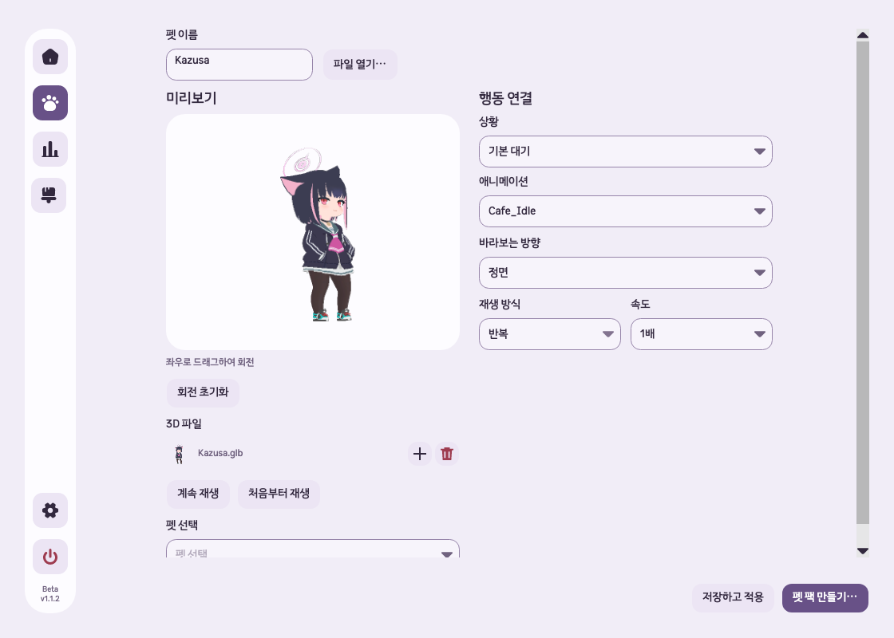

# GLB 미리보기 회전 검증

2026-10-09 · macOS arm64 · .NET 10 · Avalonia 12.1.2

## 기준과 변경

- 기준 경로: `/Users/hwanghyeonseong/Documents/GitHub/Unfold/.worktrees/remove-unused-features`
- 브랜치: `codex/remove-unused-features`, 변경 전 HEAD `4858b28`, 프로젝트 `1.1.2-beta`.
- 다섯 작업트리의 HEAD·버전·변경을 비교했다. 이 작업트리는 변경 전 깨끗했고 `codex/glb-import-compat`보다 14커밋 앞섰으며, 배포 태그 `v1.1.2-beta`보다 문서 커밋 2개 앞섰다.
- 펫 관리의 GLB 미리보기 영역에서 좌우 드래그로 360° 회전한다. ←/→는 15°씩 회전하며 Home과 **회전 초기화**는 행동의 설정 방향으로 돌아간다.
- 회전은 뷰의 임시 상태다. 저장·내보내기·행동별 방향·공유 프레임은 변경하지 않는다. 애니메이션을 다시 시작하지 않고 일시정지·종료 자세도 돌려 볼 수 있다.
- 새 파일·펫 열기와 파일 제거 시 회전을 초기화한다. 드래그 종료·포인터 캡처 해제·화면 전환·폐기 시 드래그를 종료한다.
- 고정된 수평 반경과 모델 중심으로 미리보기를 맞춰 원점에서 떨어진 모델도 회전 중 가운데에 유지한다. 프레임 계산 중 들어온 회전 요청은 최신 각도로 갱신한다.

## 소유 파일

- `src/Unfold.Desktop/GlbPetView.cs`: 입력, 포커스·안내, 초기화, 수명 관리.
- `src/Unfold.Desktop/AnimationView.cs`: 미리보기 각도와 비동기 프레임 갱신.
- `src/Unfold.Core/GlbModel.Rendering.cs`: 공유 프레임을 변경하지 않는 회전 렌더링.
- `Tests/Unfold.Tests/GlbPreviewRotationTests.cs`: 원점 밖 모델·공유 프레임 보존·드래그·캡처 해제·저장·키보드·종료 자세·초기화·창 크기 검사 5개.
- `docs/glb-pets.md`: 로컬 개발 기능과 공개 설치본의 차이 설명.

## 자동 검사

| 검사 | 결과 |
|---|---|
| 변경 전 GLB 집중 검사 | 89/89 통과 |
| 변경 후 Release 빌드 | 제품·테스트 프로젝트 경고 0, 오류 0 |
| 새 회전 검사 | 5/5 통과 |
| GLB·펫 편집·탭·클릭 통과 관련 검사 | 110/110 통과 |
| 전체 회귀 검사 | 798개 중 796 통과, 로컬 소켓 권한으로 계정 콜백 2개 중단 |
| 중단된 계정 콜백 검사 재실행 | 로컬 소켓을 허용한 환경에서 2/2 통과; 최종 798개 모두 검증 |
| 최소 640×560·기본 1120×800 | 가로 넘침 없음 |
| diff 형식 | `git diff --check` 통과 |

VSTest가 샌드박스에서 로컬 소켓을 열지 못해 xUnit v3 in-process runner로 실행했다. 통과한 검사는 다시 실행하지 않았다. 결과 XML은 `/private/tmp/unfold-glb-rotation-tests/`에 있다.

## 실제 macOS 확인

최신 소스를 참조한 임시 검증 앱에서 실제 `SettingsWindow`의 **펫 관리** 화면을 열었다. 실행마다 새 `UNFOLD_DATA_DIR`을 사용했으며, `/Users/hwanghyeonseong/Downloads/Kazusa.glb`를 불러왔다. 모델과 검증 앱은 저장소·배포물에 포함하지 않는다.

- CUA의 실제 마우스 입력으로 미리보기 정면에서 옆면으로 회전했다. 드래그를 마친 후 포인터를 미리보기 밖으로 옮겨도 회전이 멈춘 상태를 유지했다.
- **일시정지** 상태에서 회전했고 **계속 재생** 상태를 유지했다.
- **회전 초기화**로 원래 정면을 복원했다.
- 실제 ← 키 입력 3회로 각도가 약 88.04°에서 43.04°로 변경됐으며 렌더링 각도도 일치했다.
- 네이티브 창의 현재 렌더링을 캡처하고 CUA 화면과 비교했다.

## 검증 경계

실제 Windows 입력·렌더링과 장시간 자원 사용은 확인하지 않았다. Windows 관련 기존 자동 검사는 통과했다. 이번 변경은 로컬 개발 소스이며 커밋·공개 배포·설치 앱 교체는 수행하지 않았다.
