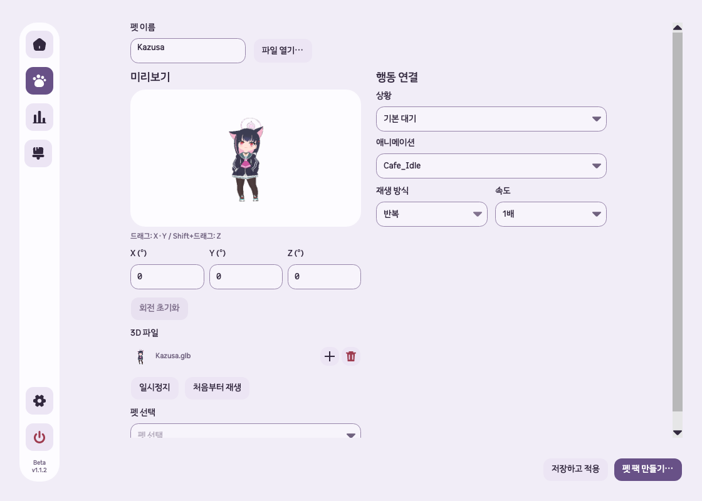
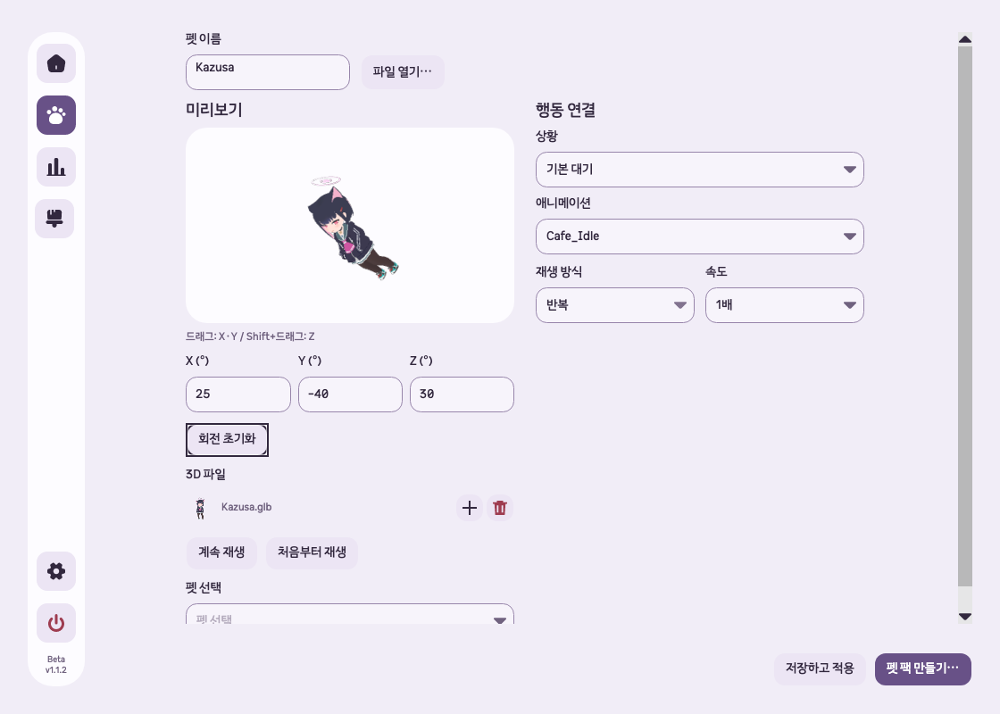

# GLB XYZ 방향 저장 구현·검증

## 원인

기존 행동 설정은 Y축 방향만 저장했다. 앞서 추가한 미리보기 드래그도 Y축 회전만 지원하며 저장 설정과 분리되어 있었다. 사용자는 행동 설정의 방향 드롭다운을 없애고 미리보기에서 정한 XYZ 방향을 실제 펫에 적용하도록 요청했다.

## 변경

- 행동 설정의 `바라보는 방향` 드롭다운을 제거했다.
- 미리보기 드래그는 X·Y축, Shift+드래그는 Z축을 조절한다. X/Y/Z 각도 입력과 방향 키, Shift+좌우 키, 전체 회전 초기화를 제공한다. 입력 범위는 −180°~180°이며 드래그·방향 키는 360° 경계를 순환한다.
- 선택한 행동의 회전을 초안에 저장하고 변경 표시·저장·내보내기에 포함한다. 행동 전환·다시 열기 시 각도를 복원한다. 미지정 행동에서는 회전을 비활성화한다.
- 일시정지와 완료된 한 번 재생의 자세는 회전 중에도 유지한다. 비동기 회전 갱신은 최신 값을 적용하며 포인터 캡처 해제 후 드래그가 남지 않는다.
- 공통 모델과 행동의 `rotation: { x, y, z }`를 지원한다. 기존 `heading`은 Y축으로 해석한다. XYZ 미수정 행동의 기존 렌더링은 유지하며, 새로운 XYZ 값은 X → Y → Z 순으로 적용한다. 새 XYZ 회전의 표시 경계는 모델 중심과 동일 배율을 유지하도록 잡고 실제 재생에도 같은 경계를 사용한다.
- 변경한 행동의 Y값은 이전 버전 호환용 `heading`에도 기록한다. 원본 GLB는 수정하지 않는다.

## 소유 파일

Core: `GlbRotation.cs`, `GlbModel.cs`, `GlbModel.Rendering.cs`, `CharacterLibrary.cs`, `GlbPetDraft.cs`.
Desktop: `AnimationView.cs`, `GlbPetView.cs`, `GlbDiagnostics.cs`.
검사: `GlbPreviewRotationTests.cs`, `GlbRotationPersistenceTests.cs`, 기존 `GlbEditorUxTests.cs`, `GlbFileManagementTests.cs`, `PetBuilderTests.cs`.
안내: `docs/glb-pets.md` 및 이 기록.

## 검증

실행 기준은 `/Users/hwanghyeonseong/Documents/GitHub/Unfold/.worktrees/remove-unused-features`, `codex/remove-unused-features`, HEAD `4858b28`, 프로젝트 `1.1.2-beta`다. 작업 전 모든 후보 작업 트리의 브랜치·HEAD·버전·변경 상태와 분기 차이를 비교했다. 기존 미커밋 미리보기 회전 작업을 이어서 수정했다.

- 변경 전 GLB 검사: 94개 통과.
- Release 제품·검사 빌드: 경고 0, 오류 0.
- GLB·펫 빌더 집중 검사: 110개 통과, 실패·건너뜀 0.
- 전체 Release 회귀 검사: 805개 통과, 실패·건너뜀 0. 인증 루프백 검사에 필요한 로컬 포트를 허용한 실행이다.
- 숫자 공간 확보를 위한 최종 입력칸 변경 후 미리보기·편집 UI 검사: 20개 통과. 최종 Release 빌드 경고·오류 0.
- 축별 렌더링 변화, 원점에서 벗어난 모델의 표시 경계, 공유 프레임 불변성, 재생 종료 유지, 포인터 캡처, 행동별 복원, 기존 heading 호환, 잘못된 회전 데이터 거부를 검사했다.
- 저장·팩 내보내기·재설치의 실제 `CharacterPackage.LoadAnimation` 출력이 회전 미리보기와 첫 프레임·중간·완료 프레임에서 픽셀 단위로 일치했다. 속도·반복 수정 시 XYZ가 유지되고 원본 GLB 바이트도 동일했다.
- 최소 640×560과 기본 1120×800 창에서 수평 넘침이 없고, 네 테마에서 XYZ 입력이 표시되며 제거한 방향 컨트롤이 없는 것을 검사했다.
- `git diff --check` 통과.

### 실제 macOS 입력

별도 임시 검증 앱을 사용하며 실행마다 새 `UNFOLD_DATA_DIR`를 생성했다. 사용자 설치본이나 실제 프로필은 교체하지 않았다. Kazusa GLB는 로컬 샘플로만 읽었으며 저장소·배포물에 포함하지 않는다.

CUA 네이티브 입력으로 일시정지 후 드래그를 실행했다. X `49.315067°`, Y `58.695652°`로 갱신되었고, Shift+오른쪽 키는 Z `15°`를 적용했다. 직접 입력으로 X `25°`, Y `−40°`, Z `30°`를 지정한 뒤 저장했다. 미리보기 요청·렌더링 값과 적용된 패키지의 회전이 모두 같았으며 미저장 표시가 해제됐다. 편집 버튼으로 다시 열어 세 각도가 복원되고 저장 버튼이 비활성 상태인 것을 확인했다. Z축 Shift+드래그는 자동 입력 검사로 검증했다.

최종 숫자 입력칸은 증감 버튼을 감춰 음수·소수 값의 표시 공간을 확보했다. 최종 앱에서도 키보드 직접 입력과 XYZ 화면을 다시 확인하고 저장했다.

검사 집계와 네이티브 저장 상태는 같은 이름의 자산 폴더에 보관한다. 이전 미리보기 전용 회전 기록은 당시 결과로 유지한다.

## 미검증·위험

실제 Windows 입력과 화면은 이번 작업에서 확인하지 않았다. 새로운 XYZ 회전은 기존 방향 전용 경계보다 여백이 생길 수 있으며, 극단적인 관절 움직임까지 자동으로 확대·축소하는 카메라는 제공하지 않는다. 로컬 미커밋 변경이며 공개 배포나 설치 앱 업데이트는 수행하지 않았다.
