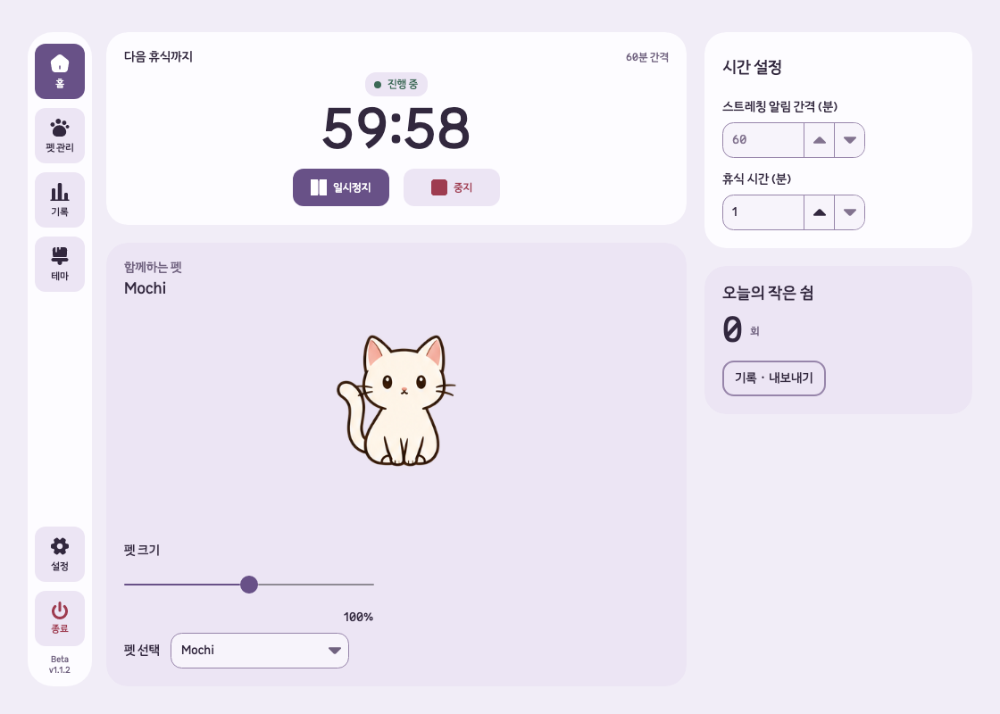
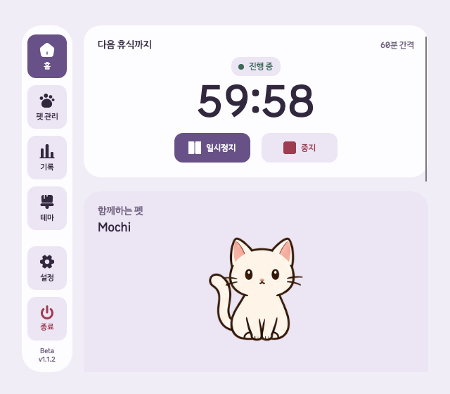

# 내비게이션 아이콘 아래 이름 표시 검증

검증일: 2026-10-09. 로컬 구현이며 커밋·배포하지 않았다.

## 기준과 변경

작업 전 후보 worktree의 브랜치, HEAD, 미커밋 변경, csproj 버전과 커밋 관계를 비교했다. 기준은 `.worktrees/remove-unused-features`, `codex/remove-unused-features`, HEAD `4858b28`, `1.1.2-beta`다. 기존 GLB 회전 관련 미커밋 변경을 보존했다.

기존 사이드바는 아이콘과 툴팁으로 항목을 구분했다. 홈·펫 관리·기록·테마·설정·종료 이름을 각 아이콘 아래에 항상 표시하도록 변경했다. 이름은 버튼의 테마·선택·종료 색상을 상속하며 기존 클릭 동작과 접근성 이름을 유지한다. 사이드바 폭은 72px, 버튼은 58×64px, 버튼 사이 간격은 8px로 조정했다.

변경 파일은 `SettingsWindow.Layout.cs`, `SettingsWindow.Themes.cs`, 관련 검사 두 파일과 `docs/settings-ui.md`다.

## 자동 검사

- 변경 전 `SettingsDashboardTests`와 `NavigationIconTests`: 13개 통과, 실패 0개.
- Release 제품·검사 빌드: 경고 0개, 오류 0개.
- 변경 후 대시보드·아이콘·테마·색상·탐색 보호·설정 UI 검사: 34개 통과, 실패·건너뜀·검사 실행 오류 0개.
- 네 가지 테마에서 1120×800 및 640×560 창의 이름 표시, 텍스트 잘림, 아이콘 아래 배치, 색상 상속, 버튼 경계와 상·하단 그룹 겹침을 검사했다.
- 테마 이름 중앙을 마우스로 클릭해 선택 창이 열리는 것을 headless 검사로 확인했다.
- `git diff --check` 통과.

결과 요약: [변경 전](2026-10-09-navigation-labels/unfold-nav-labels-before-summary.json), [변경 후](2026-10-09-navigation-labels/unfold-nav-labels-focused-final-summary.json).

별도 탐색으로 `ThemeTests`만 단독 실행했을 때 headless 초기화의 UI 스레드 순서 문제로 정리 오류 3개가 발생했다. 이후 관련 UI 검사 그룹의 정상 실행에서는 위 34개가 모두 통과했다. 테마 초기화 기반 코드는 이번 변경 범위에 포함하지 않았다.

## macOS 실제 실행

최신 경로의 제품 프로젝트를 참조하는 임시 검증 앱을 실행했다. 매 실행에 새 `UNFOLD_DATA_DIR`을 사용했다. 기본 1120×800 창과 최소 640×560 창에서 여섯 이름과 버전 표시가 잘리거나 겹치지 않는 것을 확인했다. 최소 크기 검증에서는 진단 실행기가 강제하는 최소 크기를 검증 앱에서 640×560으로 설정했다. [최소 창 크기 및 이름 위치](2026-10-09-navigation-labels/native-minimum.json)를 함께 저장했다.

실제 macOS 입력으로 펫 관리 이름을 클릭해 페이지 전환과 선택 표시를 확인했고, 종료 이름을 클릭해 확인 창이 열리는 것을 확인했다. 검증 앱은 종료했다. 테마 선택 창 열림은 자동 검사로 확인했으며 실제 OS 입력으로는 이번에 확인하지 못했다.

## 검증 경계

Windows 실제 실행과 전체 검사 모음 재실행은 이번 작은 내비게이션 변경의 검증 범위에 포함하지 않았다. 위 결과는 관련 자동 검사와 macOS 로컬 실행 근거다. 설치 앱이나 공개 배포 버전은 변경하지 않았다.
