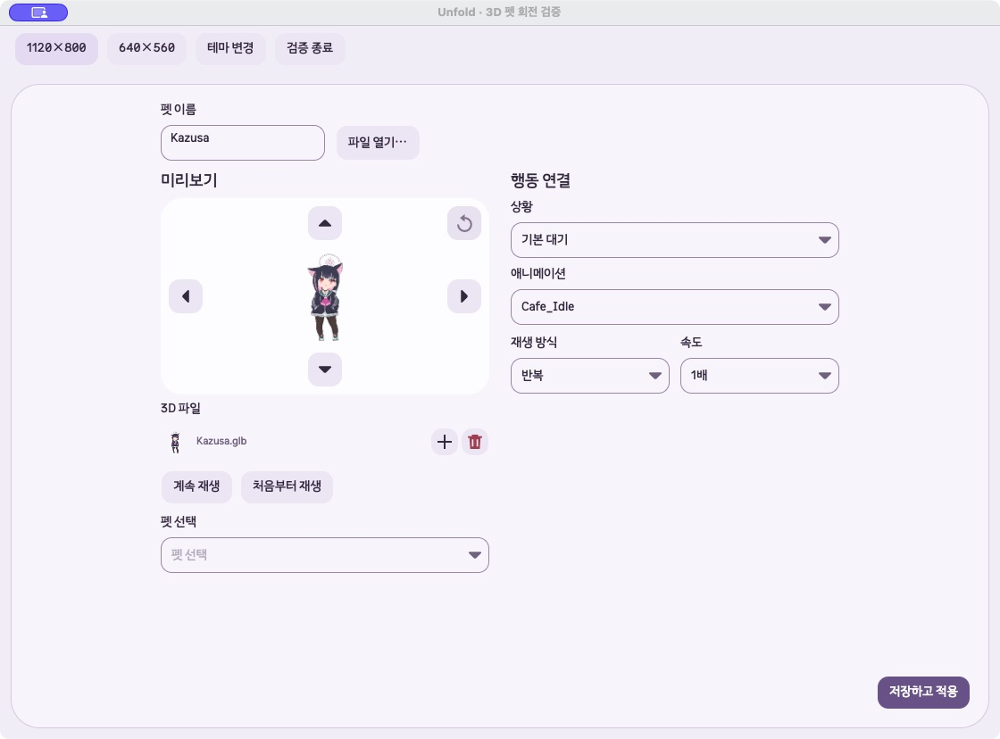
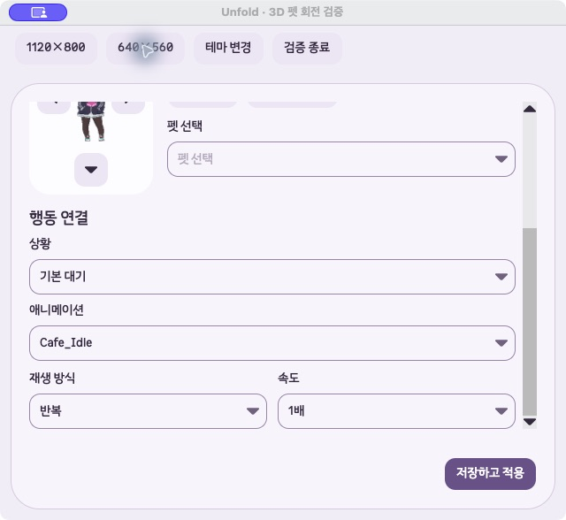

# GLB 미리보기 내부 화살표 구현·검증

2026-10-13 로컬 변경. 커밋·배포하지 않았다.

## 기준과 변경

최신 개발본 `/Users/hwanghyeonseong/.codex/worktrees/gif-glb-guidance/Unfold`, `codex/gif-glb-import-guidance`, HEAD `814cfbe`, 프로젝트 버전 `1.1.3-beta`에서 진행했다. 모든 worktree의 HEAD·브랜치·변경·버전을 다시 대조했으며 이전 작업 경로 `6f0a3dd`보다 제품 커밋 4개가 앞선다.

사용자는 XYZ 입력을 없애고 네 방향 버튼을 미리보기 안에 배치하도록 수정 요청했다. [이전 십자 패드 검증](2026-10-13-glb-rotation-arrows.md)은 당시 결과로 보존했다.

- XYZ 숫자 입력과 해당 이벤트·비활성화 코드를 제거했다.
- 위·아래 버튼은 미리보기 위아래 중앙, 좌·우는 양옆 중앙에 배치했다. 초기화는 오른쪽 위다. 40×40px 공통 버튼·SVG·접근성 이름·툴팁을 사용한다.
- 드래그와 방향키의 Z축 조절을 제거했다. Shift 입력도 XY만 변경한다. 좌우·위아래 15°씩, 360°를 넘어 계속 회전한다.
- 버튼 클릭·드래그가 모델 드래그의 포인터 캡처를 시작하지 않도록 했다. 방향키는 미리보기의 한 이벤트 처리 경로로 연결했다.
- GLB 미리보기 최소 높이를 220px로 확보하고 위아래 버튼 공간을 제외한 모델 표시 영역을 유지했다. 공유 편집 레이아웃의 기본값은 140px로 유지해 영상 펫의 기존 배치를 보존했다.
- 기존 저장 파일의 Z 값은 XY 조작·저장·재열기에서 보존한다. 초기화하면 모든 저장 각도를 0°로 되돌린다. 저장 형식·렌더러는 이번 작업에서 수정하지 않았다.

제품 소유 파일은 `GlbPetView.cs`, `PetEditorWorkspace.cs`, `GlbDiagnostics.cs`다. 진단·기존 테스트의 숫자 입력 사용을 화살표 또는 모델 드래그로 바꾸고 기존 저장·팩 생성·회전 후 높이 검증 조건을 유지했다.

작업 시작 당시 변경 중이던 파일 중 이번 범위 외 22개는 SHA-256이 그대로다. 사용자 모션·재생·렌더러 변경과 이전 검증 파일을 보존했다. 두 기존 사용자 테스트 파일은 제거된 입력 사용만 전환했다. [보존 결과](2026-10-13-glb-preview-overlay-arrows/preservation.json)

## 자동 검사

검사는 최신 경로에서 실행하고 매번 새 `UNFOLD_DATA_DIR`을 사용했다.

| 검사 | 결과 |
|---|---|
| Release 제품·테스트 빌드 | 경고 0, 오류 0 |
| 회전·입력·저장·높이·펫 생성·파일 관리 관련 검사 | 99개 통과, 실패·건너뜀·실행 오류 0, 25.454초 |
| 전체 검사 | 887개 통과, 실패·건너뜀·실행 오류 0, 127.216초 |
| 변경 형식 | `git diff --check` 통과 |

새 회전 버튼 검사는 총 30개 사례다. 각 방향 15°·두 바퀴 회전·±180° 경계, 행동별 기존 Z 저장값 보존·초기화, 정지·완료 자세와 시간 유지, Headless 실제 포인터 클릭·버튼에서 드래그 취소·캡처 해제, Shift 방향키·드래그의 XY 동작, 640×560·1120×800에서 내부 배치·비겹침·최소 모델 영역·Tab·Space·Home을 확인했다.

[빌드](2026-10-13-glb-preview-overlay-arrows/build.log), [관련 검사](2026-10-13-glb-preview-overlay-arrows/focused-summary.json), [전체 검사](2026-10-13-glb-preview-overlay-arrows/full-summary.json)

## 실제 macOS

최신 제품 프로젝트를 참조하는 임시 검증 앱에서 Kazusa GLB를 새 격리 라이브러리로 열었다. 검증용 창 크기·테마·종료 버튼 외에는 제품 컨트롤이다.

CUA 입력으로 위·오른쪽 버튼과 Shift+Right에서 X −15° / Y 45° / Z 0°를 확인했다. 왼쪽 버튼에서 모델 중앙으로 드래그해도 값이 변하지 않았다. 아래·위·왼쪽 클릭 후 X −15° / Y 30° / Z 0°를 저장했다. 스크롤 후 편집으로 다시 열어 같은 방향, 미저장 변경 없음, 저장 버튼 비활성화를 확인했다. 저장 파일 `character.json`의 idle 회전도 일치했다. [저장 직후](2026-10-13-glb-preview-overlay-arrows/native-after-input.json), [재열기](2026-10-13-glb-preview-overlay-arrows/native-reopened.json), [저장 파일](2026-10-13-glb-preview-overlay-arrows/saved-pet.json)

첫 검증 실행기의 별도 페이지 제목과 검증용 상단 버튼이 최소 창 높이를 더 사용했다. 최종 화면 확인은 실제 `PetBuilderView`와 같은 `showHeader: false`로 실행기를 맞췄다. 640×560 첫 화면에서 펫·네 화살표·초기화가 모두 보였다. 1120×800도 확인했다. 검증 앱은 종료했다.

## 미검증

Windows 실제 입력, VoiceOver·Narrator, 설치 파일·공개 배포는 이번 작업에서 검증하지 않았다. 버전은 `1.1.3-beta`로 유지한다.
