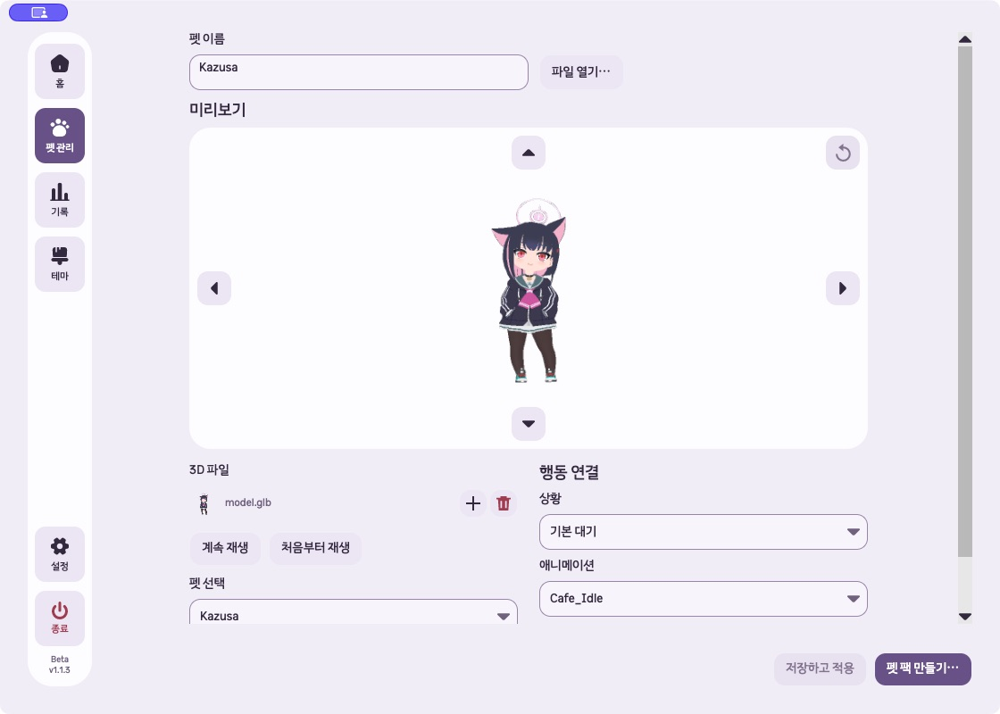
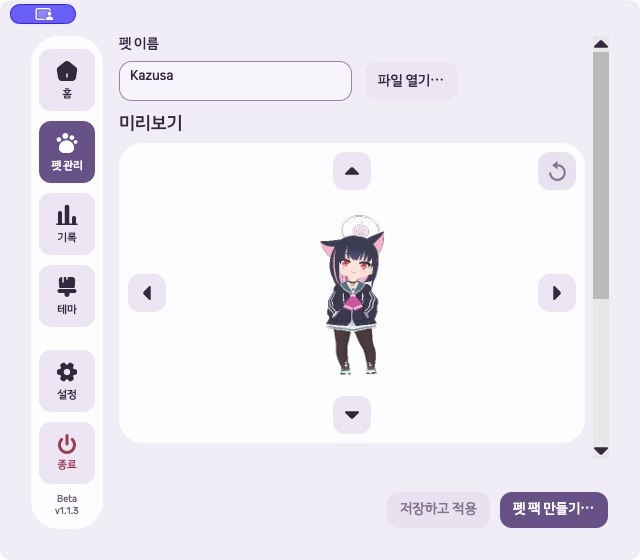

# GLB 미리보기 높이·펫 표시 크기 구현과 검증

2026-10-13 로컬 변경. 커밋·배포하지 않았다.

## 기준과 변경

모든 worktree의 브랜치·HEAD·미커밋 변경·프로젝트 버전과 커밋 관계를 다시 확인했다. 최신 개발본은 `/Users/hwanghyeonseong/.codex/worktrees/gif-glb-guidance/Unfold`, `codex/gif-glb-import-guidance`, HEAD `814cfbe`, 버전 `1.1.3-beta`다. 이전 작업 경로 `6f0a3dd`보다 제품 커밋 4개가 앞선다. 공개 태그 `v1.1.3-beta`의 소스는 `b1242ea`로 재확인했다.

사용자는 미리보기 높이와 3D 펫의 기본 표시 크기 확대를 요청했다.

- 기본 1120×800 창의 GLB 미리보기 높이를 220px에서 360px로 확대했다. 모델 표시 캔버스는 124×124px에서 264×264px로 커져 기본 표시가 약 2.1배다.
- 작은 창에서는 본문 뷰포트에서 펫 이름·미리보기 제목과 여유 공간을 제외한 높이에 맞춰 220~360px로 조정한다. 실제 640×560 설정 창에서는 300px이다.
- 스크롤 오프셋을 보정해 하단 설정으로 스크롤해도 높이나 표시 크기가 바뀌지 않는다. 창을 다시 키우면 360px로 복원된다.
- 회전 버튼 공간, 전체 폭 미리보기와 하단 좌우 설정 배치를 유지한다. 창·뷰포트 변경으로 크기를 갱신하고 페이지가 분리될 때 이벤트 구독을 해제한다.

제품 소유 파일은 `GlbPetView.cs`와 `PetEditorWorkspace.cs`다. 확대는 미리보기의 표시 공간에 적용한다. 모델의 저장·렌더링 크기 계약과 기존 바탕화면 크기 설정은 변경하지 않았다. 영상 편집기의 기존 크기 동작도 유지했다.

기존 작업 중 이번 범위 외 50개 파일의 SHA-256이 일치한다. 사용자 렌더러·재생 변경과 이전 UI 작업·검증 자료를 보존했다. [보존 결과](2026-10-13-glb-preview-size/preservation.json)

## 자동 검사

빌드·검사는 최신 경로에서 새 `UNFOLD_DATA_DIR`로 실행했다.

| 검사 | 결과 |
|---|---|
| 최종 Release 제품·테스트 빌드 | 경고 0, 오류 0, 4.08초 |
| 최초 관련 검사 | 97개 중 96개 통과, 작은 창 중앙 정렬 기대에서 1개 실패 |
| 최종 회전·확대 배치 검사 | 45개 통과, 실패·건너뜀·실행 오류 0, 11.614초 |
| 전체 검사 | 902개 통과, 실패·건너뜀·실행 오류 0, 139.387초 |
| 변경 형식 | `git diff --check` 통과 |

최초 실패는 가용 높이에 따라 패드가 홀수 높이가 되면서 픽셀 반올림으로 버튼 중심이 0.5px 이동한 경우다. 정확히 0.1px까지 같다고 가정했던 검사만 실제 레이아웃 반올림을 고려한 1px 허용으로 보완했다. 내부 배치·버튼 크기·비겹침·가시성 검증은 유지했다.

확대 검사는 기본 창 캔버스 260~265px, 헤더 유무, 창 축소·복원, 스크롤 후 크기 유지와 최소 설정 창에서 모델·화살표의 가시성을 확인한다. 기존 회전·행동별 저장·재열기·초기화·저장 전후 모델 기준 높이·영상 편집·반응형 검사가 전체 통과했다.

[빌드](2026-10-13-glb-preview-size/build.log), [초기 관련 검사](2026-10-13-glb-preview-size/focused-summary.json), [최종 배치 검사](2026-10-13-glb-preview-size/layout-final-summary.json), [전체 검사](2026-10-13-glb-preview-size/full-summary.json)

## 실제 macOS

최신 제품 어셈블리의 실제 `SettingsWindow`·`PetBuilderView`를 임시 실행기에서 열고, Kazusa GLB를 새 격리 라이브러리에 저장해 확인했다. 크기·종료용 함수 키 외에 별도 화면 컨트롤을 추가하지 않았다.

기본 1120×800: 미리보기 760×360px, 모델 캔버스 높이 264px, 현재 자세의 불투명 픽셀을 화면 좌표에 투영한 펫 높이 약 206px다. [기본 크기 복원 상태](2026-10-13-glb-preview-size/native-restored-state.json)

최소 640×560: 미리보기 466×300px, 모델 캔버스 204px, 펫 높이 약 159px다. 위·아래·좌·우와 초기화 버튼이 첫 화면 안에 들어왔다. 하단 설정으로 실제 스크롤한 뒤에도 미리보기 300px·캔버스 204px를 유지했다. 기본 창으로 복원하면 360px·264px로 돌아왔다. [최소 창](2026-10-13-glb-preview-size/native-minimum-state.json), [스크롤 후](2026-10-13-glb-preview-size/native-scrolled-state.json)

펫 높이는 Kazusa의 측정 자세 기준이며 모든 모델에서 같은 절대 높이가 된다는 의미는 아니다. 표시 공간의 확대 비율은 동일하게 적용한다. 검증 실행기는 종료했다.

[최소 창 하단 설정](2026-10-13-glb-preview-size/native-minimum-settings.png)

## 미검증

Windows 실제 입력, VoiceOver·Narrator, 설치 파일과 공개 배포는 이번 작업에서 검증하지 않았다. 버전은 `1.1.3-beta`로 유지한다.
