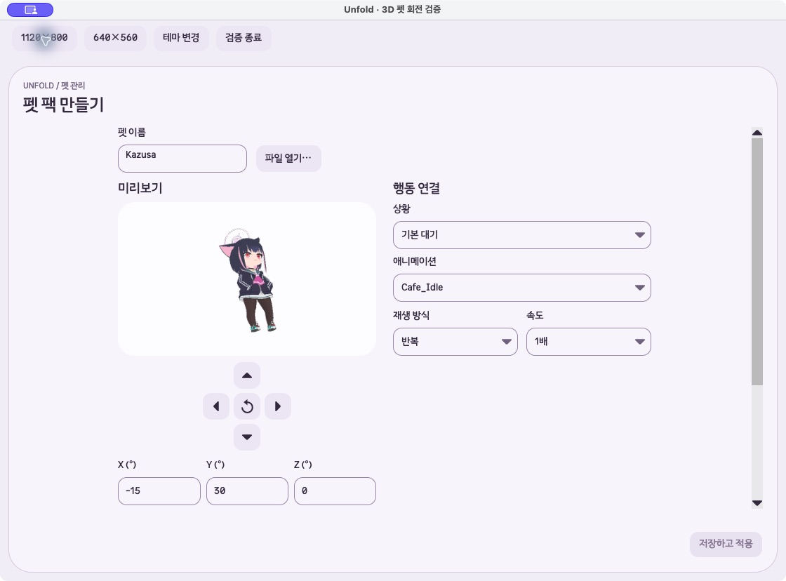
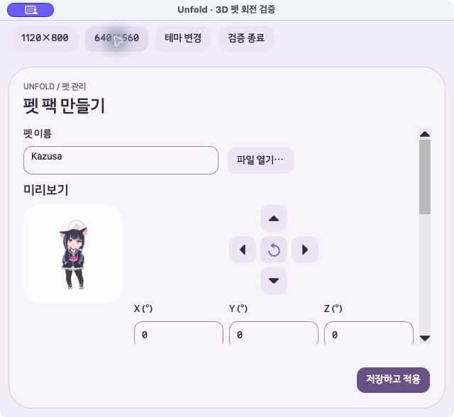

# GLB 회전 화살표 구현·검증

2026-10-13 로컬 변경. 커밋·배포하지 않았다.

## 기준과 원인

모든 worktree의 브랜치·HEAD·미커밋 변경·프로젝트 버전과 커밋 관계를 대조했다. 최신 개발본은 `/Users/hwanghyeonseong/.codex/worktrees/gif-glb-guidance/Unfold`, `codex/gif-glb-import-guidance`, HEAD `814cfbe`, `1.1.3-beta`다. 기존 작업 경로 `remove-unused-features`의 `6f0a3dd`보다 제품 커밋 네 개 앞서 있다. 원격 공개 태그는 `v1.1.3-beta`, 제품 소스 `b1242ea`다.

기존 코드는 X·Y 360° 드래그·키보드 회전과 행동별 XYZ 저장을 지원했지만 화면에 방향 버튼이 없었다. 최신 개발본의 회전 안정화·높이 정규화와 진행 중인 모션 변경을 보존했다. 작업 시작 당시 미커밋 파일 11개의 SHA-256이 종료 시점에도 모두 일치했다.

## 변경

- 미리보기 아래에 위·왼쪽·초기화·오른쪽·아래 십자 패드를 추가했다. 버튼은 40×40px, 패드는 128×128px다. 기존 방향 SVG와 공통 버튼 테마를 사용한다.
- 좌우는 Y축, 위아래는 X축을 15°씩 조절한다. ±180°를 넘어 계속 회전하며 24회로 360°를 돌아온다. 기존 Z 각도는 보존한다.
- 패드와 미리보기에서 방향 키·Home을 같은 처리로 연결했다. Shift+좌우의 Z축 조작, 드래그, 각도 입력과 저장은 유지한다. Tab·Space와 접근성 이름·툴팁을 제공한다.
- 가운데 초기화에 기존 초기화 동작을 연결했다. 중복된 회전 설명과 별도의 초기화 줄을 제거했다.
- 작은 창에서 미리보기를 위쪽으로 정렬해 펫과 패드가 함께 보이게 했다. 새 패드가 높아지면서 미리보기가 아래로 밀리는 현상을 실제 macOS에서 발견했고 가시성 검사로 재현했다.
- 전체 검사에서 기존 모션 검사 준비 데이터가 이미 제거된 `held` 이벤트를 등록해 4개 검사가 실패했다. 준비 데이터 두 줄만 현재 `GlbPetDraft.PointerClips` 계약에 맞췄다. 기존 재생 관련 검증 조건은 유지했다.

제품 변경은 `GlbPetView.cs` 한 파일이다. 새 `GlbRotationButtonsTests.cs`와 기존 `PetMotionContinuationTests.cs`의 준비 데이터, 관련 사용 안내와 이 보고서를 함께 갱신했다. 렌더러·저장 형식·펫 런타임은 이번 작업에서 추가 수정하지 않았다.

## 자동 검사

모든 검사·진단 실행에 새 `UNFOLD_DATA_DIR`을 사용했다.

| 검사 | 결과 |
|---|---|
| 버튼 추가 전 새 회귀 검사 | 19개 모두 버튼 부재로 실패, 실행 오류 0개 |
| 최초 관련 검사 | 94개 통과, 실패·건너뜀·실행 오류 0개 |
| 최소 창 가시성 재현 | 19개 중 최소 창 1개 실패: 미리보기 끝 506px, 뷰포트 끝 457px |
| 최초 전체 검사 | 876개 중 872개 통과, 기존 `held` 준비 데이터 관련 4개 실패 |
| 최종 Release 제품·검사 빌드 | 경고 0개, 오류 0개, 6.50초 |
| 최종 관련 검사 | 109개 통과, 실패·건너뜀·실행 오류 0개, 24.676초 |
| 최종 전체 검사 | 876개 통과, 실패·건너뜀·실행 오류 0개, 115.789초 |
| 변경 형식 검사 | `git diff --check` 통과 |

새 검사는 방향별 15°, 각 방향의 두 바퀴 회전, ±180° 경계, 일시정지·종료 자세와 시간 보존, 행동별 저장·다시 열기, 비어 있거나 미지정인 상태의 비활성화, 640×560·1120×800에서 미리보기·패드 가시성과 Tab·Space·방향키·Home을 검증한다.

[버튼 수정 전](2026-10-13-glb-rotation-arrows/buttons-before-summary.json), [최소 창 재현](2026-10-13-glb-rotation-arrows/layout-before-summary.json), [최종 관련 검사](2026-10-13-glb-rotation-arrows/focused-final-summary.json), [최종 전체 검사](2026-10-13-glb-rotation-arrows/full-final-summary.json)에 결과를 보관했다.

## 실제 macOS 확인

최신 제품 프로젝트를 참조하는 임시 검증 앱에서 실제 Kazusa GLB를 새 격리 라이브러리에 가져왔다. 검증용 창 크기 버튼 외의 편집 컨트롤은 제품 코드다. 검증 앱의 최초 테마 API 정정과 이미지 저장 API의 폐기 경고는 임시 실행기에 한정됐으며 제품 빌드 경고는 0개다.

CUA 입력으로 오른쪽 버튼 12회→Y 180°, 추가 12회→Y 0°를 확인했다. 아래 버튼 12회→X 180°에서 모델이 뒤집히고 추가 12회→X 0°로 돌아왔다. 위·오른쪽 클릭과 버튼 포커스에서 Down·Left 키도 확인했다.

최종 배치에서 640×560으로 줄여 펫과 다섯 버튼이 모두 보이는 것을 확인했다. 위 1회·오른쪽 2회로 X −15° / Y 30° / Z 0°를 저장하고, 스크롤로 편집 버튼에 접근해 다시 열었다. 같은 세 각도가 복원됐으며 미저장 변경이 없고 저장 파일의 idle 회전도 일치했다. [최종 상태](2026-10-13-glb-rotation-arrows/native-state-final.json)를 함께 저장했다. 검증 앱은 종료했다.

[위아래 180° 화면](2026-10-13-glb-rotation-arrows/native-vertical-180.png)과 변경 전 화면도 보관했다.

## 미검증

Windows 실제 입력, VoiceOver·Narrator, 설치 파일과 공개 배포는 이번 범위에 포함하지 않았다. 버전은 `1.1.3-beta`로 유지하며 공개 설치본에는 새 화살표가 아직 포함되지 않는다.
