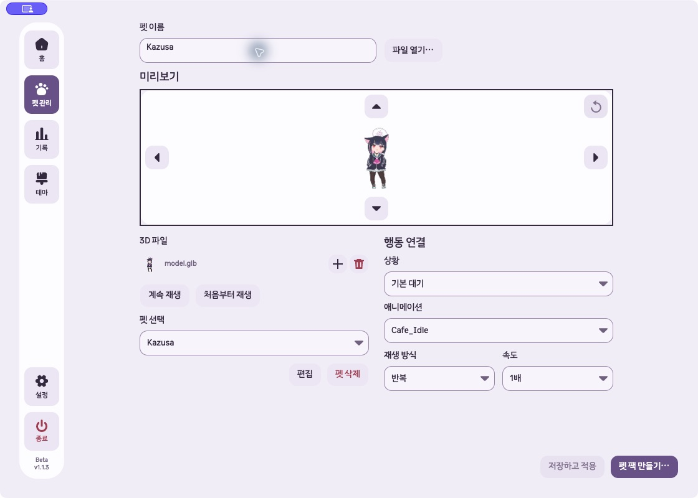
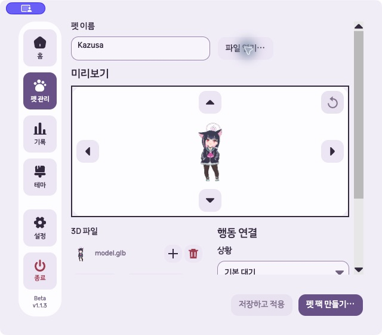
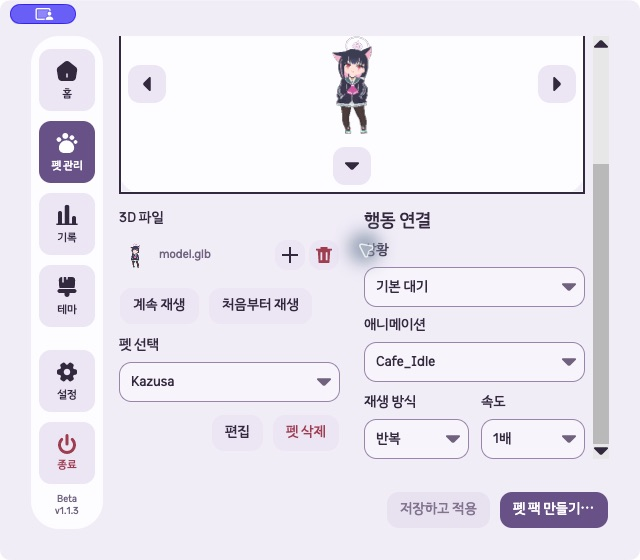

# GLB 미리보기 확장·설정 배치 구현과 검증

2026-10-13 로컬 변경. 커밋·배포하지 않았다.

## 기준과 변경

모든 worktree의 브랜치·HEAD·미커밋 변경·프로젝트 버전과 커밋 관계를 다시 확인했다. 최신 개발본은 `/Users/hwanghyeonseong/.codex/worktrees/gif-glb-guidance/Unfold`, `codex/gif-glb-import-guidance`, HEAD `814cfbe`, 버전 `1.1.3-beta`다. 이전 작업 경로 `6f0a3dd`보다 제품 커밋 4개가 앞선다. 원격 공개 태그 `v1.1.3-beta`는 제품 소스 `b1242ea`로 재확인했다.

사용자는 펫 팩 만들기의 미리보기를 기존 행동 연결 영역까지 확장하고 행동 연결을 3D 파일·펫 선택 오른쪽에 배치하도록 요청했다.

- GLB 미리보기는 상단에서 편집 영역 전체 폭을 차지한다. 회전 화살표·초기화는 내부 가장자리 배치를 유지한다.
- 아래 왼쪽은 3D 파일·재생·펫 선택·편집/삭제, 오른쪽은 행동 연결이다. 두 영역의 위쪽을 맞추고 간격은 24px로 둔다.
- 미리보기 높이는 220px로 유지한다. 행동 설정이 길어져도 미리보기 높이에 영향을 주지 않는다. 좁은 창에서는 재생 버튼이 줄바꿈하며 하단 설정을 세로 스크롤한다.
- 키보드 탐색도 미리보기 → 파일·펫 선택 → 행동 연결 순서로 맞췄다.
- 공유 편집 레이아웃에 선택 인자를 추가하고 GLB에서만 사용한다. 영상 펫의 기존 배치·높이 계약을 유지한다.

제품 변경은 `GlbPetView.cs`와 `PetEditorWorkspace.cs`다. 기존 두 테스트 메서드의 GLB 배치 기대를 갱신하고 `GlbWorkspaceLayoutTests.cs`에 12개 사례를 추가했다. 이전 회전·재생·사용자 미커밋 변경과 검증 자료는 보존했다. 이번 범위 외 기존 변경 파일 37개의 SHA-256이 그대로다. [보존 결과](2026-10-13-glb-wide-preview/preservation.json)

## 자동 검사

최신 경로에서 빌드·검사하고 매번 새 `UNFOLD_DATA_DIR`을 사용했다.

| 검사 | 결과 |
|---|---|
| 최종 Release 제품·테스트 빌드 | 경고 0, 오류 0, 6.79초 |
| 최초 관련 검사 | 125개 중 124개 통과, 새 최소 창 준비 코드에서 1개 실패 |
| 수정한 배치 검사 | 12개 모두 통과, 실패·건너뜀·실행 오류 0, 4.735초 |
| 최종 전체 검사 | 899개 통과, 실패·건너뜀·실행 오류 0, 140.918초 |
| 변경 형식 | `git diff --check` 통과 |

최초 실패는 `PrepareDiagnosticWindow`가 시작 크기 1120×800을 최소 크기로 올려 검사에서 요청한 640×560이 제한된 준비 코드 문제였다. 제품 코드를 변경하지 않고 실제 `SettingsWindow` 생성자에 최소 크기를 설정한 뒤 표시하도록 검사 준비를 바꿨다.

검사는 헤더 유무와 폭 480·640·860·1120, 전체 폭·하단 정렬·버튼 포함·비겹침·가로 넘침 없음, 행동 내용이 길어져도 고정 높이, 키보드 순서·저장·재열기·파일 제거, 실제 SettingsWindow의 최소 크기와 영상 펫의 기존 배치를 확인한다.

[빌드](2026-10-13-glb-wide-preview/build.log), [초기 관련 검사](2026-10-13-glb-wide-preview/focused-summary.json), [최종 배치 검사](2026-10-13-glb-wide-preview/layout-final-summary.json), [전체 검사](2026-10-13-glb-wide-preview/full-summary.json)

## 실제 macOS

최신 제품 어셈블리를 사용하는 임시 실행기에서 실제 `SettingsWindow`와 `PetBuilderView`를 열고 Kazusa GLB를 새 격리 라이브러리에 저장해 편집했다. 검증용 창 크기·종료 기능은 함수 키에만 연결했으며 화면에 보조 버튼을 추가하지 않았다. 설치 파일 실행을 대신하는 검증은 아니다.

1120×800에서는 미리보기 760×220px, 하단 파일·펫 선택과 행동 연결은 각각 368px 폭으로 같은 높이에서 시작했다. 스크롤 영역에 가로 넘침이 없었다.

640×560에서는 미리보기 466×220px와 내부 화살표가 첫 화면에 모두 보였다. 하단 두 영역은 각각 221px 폭, 24px 간격을 유지했다. 실제 스크롤로 펫 선택·행동·재생 방식·속도·편집 버튼에 접근했고 footer의 저장·펫 팩 만들기 버튼은 계속 보였다. 오른쪽 상황 메뉴에서 클릭을 선택하면 해당 행동 연결로 바뀌며 배치가 유지됐다.

실제 Tab 입력으로 펫 이름 → 파일 열기 → 미리보기 초점 이동을 확인했다. 상황만 전환했을 때 미저장 변경은 생기지 않았다. 검증 앱은 종료했다.

[기본 상태](2026-10-13-glb-wide-preview/native-default-state.json), [최소 창 첫 화면](2026-10-13-glb-wide-preview/native-minimum-top.json), [최소 창 하단 설정](2026-10-13-glb-wide-preview/native-minimum-settings.json), [상황 전환](2026-10-13-glb-wide-preview/native-action-state.txt)

## 미검증

Windows 실제 입력, VoiceOver·Narrator, 설치 파일과 공개 배포는 이번 작업에서 검증하지 않았다. 버전은 `1.1.3-beta`로 유지한다.
