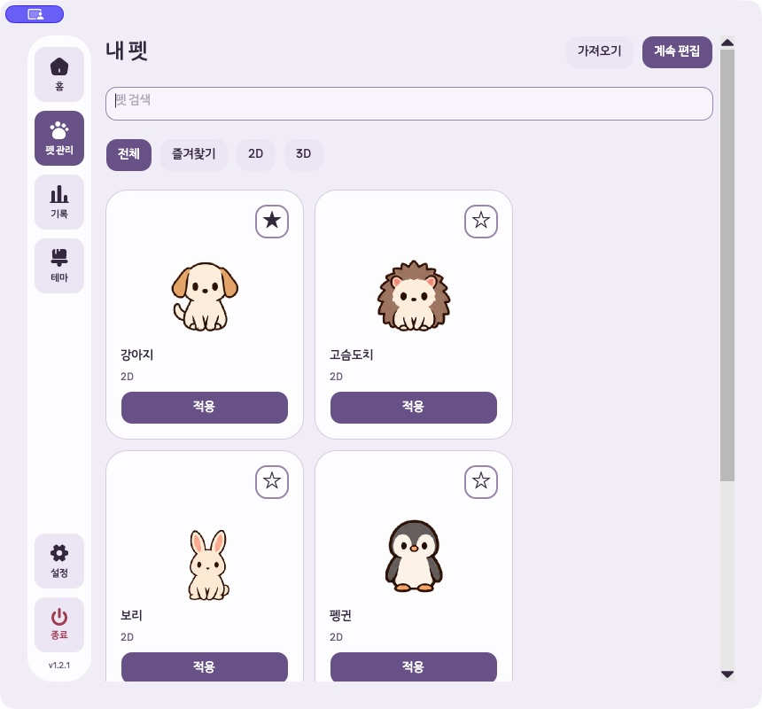

# P1 기능 실제 macOS 검증 — 2026-10-20

결과: **부분 통과 — 즐겨찾기 변경 후 키보드 포커스 유실 1건**. 내 펫 라이브러리의 주요 클릭 흐름, 펫별 크기 저장, 호버 자원 표시, 빠른 메뉴, 네 모서리 배치는 확인했다. 이번 작업에서는 제품 코드를 수정하지 않았다.

후속 상태(2026-10-21): 아래 포커스 결함은 [수정·재검증을 완료](2026-10-21-favorite-focus.md)했다. 이 문서의 재현 결과와 화면은 수정 전 기록으로 보존한다.

## 실행 기준과 격리

- 최신 개발 작업트리: `/Users/hwanghyeonseong/Developer/GitHub/Unfold/.worktrees/pet-overlay-hover`
- 브랜치/HEAD: `codex/pet-overlay-hover` / `2de478a7fb4b96bb92148b641c796a885270cf0d`
- 버전: `1.2.1`. HEAD 이후 현재 작업트리에 있는 P1 미커밋 변경까지 포함하여 실행했다.
- 시작 시 후보 작업트리의 브랜치, HEAD, 변경 사항, 버전을 비교했다. 현재 루트의 구버전 `release/mvp`는 실행하지 않았다.
- macOS `26.6.2 (25G83)`, arm64. 화면 `1920×1080`, 배율 1, 작업 영역 `(0,30)–(1920,1080)`.
- 별도 실행 앱: `/private/tmp/unfold-p1-macos-20261020/Unfold P1 QA.app`
- 별도 `UNFOLD_DATA_DIR`: `/private/tmp/unfold-p1-macos-20261020/profile`
- 기본 펫 5개와 테스트용 사용자 펫 1개를 사용했다. 설치된 앱과 실제 사용자 프로필은 변경하지 않았다.

임시 `Unfold.Tests` 호스트가 현재 작업트리의 실제 `AppRuntime`과 Avalonia 화면을 실행했다. 시작 시 `diagnostic:true`로 계정 절차를 제외하고, 이후 `DiagnosticMode=false`로 실제 macOS 전역 포인터 감지와 호버 배치를 사용했다. 따라서 **일반 설치 앱의 로그인·인증·자동 업데이트 시작 경로는 검증 범위가 아니다**.

호스트 Release 빌드는 경고/오류 0개로 성공했다. 실행한 `Unfold.dll`과 작업트리 Release 산출물의 SHA-256은 시작·종료 시 동일했다:

`9cb3a3edb862da6d10f720dfaa4e9e915476e5b4a68d82346604e66f171f6659`

## 실제 입력 결과

| 항목 | 수행 및 관찰 | 결과 |
|---|---|---|
| 내 펫 목록 | 기본·사용자 펫 카드, 적용 중 표시, 사용자 펫 편집 버튼 확인 | 통과 |
| 검색·필터 | `QA`, `Mochi` 검색; 즐겨찾기 필터; Tab과 Space로 2D/3D 필터 이동·실행; 3D 검색 결과 없음 표시 | 통과 |
| 펫 적용 | 테스트 사용자 펫을 클릭 적용; Mochi 적용 버튼에 Tab으로 이동 후 Enter 실행; 실제 선택 펫과 적용 중 표시 변경 | 통과 |
| 즐겨찾기 저장 | 별 클릭과 Space로 상태 변경; 필터 결과와 설정 파일 일치 | 저장 통과 / 포커스 결함 |
| 편집 복귀 | 사용자 펫 편집에서 이름을 `QA draft preserved`로 변경 → 목록으로 → 계속 편집; 초안 유지 | 통과 |
| 창 축소·스크롤 | 실제 창을 `860×800`으로 축소; 2열 카드와 필터 표시; 맨 아래 카드의 적용·편집까지 스크롤 접근 | 통과 |
| 펫별 크기 | 홈의 크기 조절에서 Mochi 80%, puppy 130% 설정; 다시 Mochi 선택 시 80% 복원; JSON의 펫별 값 일치 | 통과 |
| CPU·메모리 | 기본 꺼짐 확인 후 설정에서 켬; 실제 호버에서 CPU 27–33% 등 갱신 및 메모리 수치 확인 | 통과 |
| 소리 메뉴 클릭 | 빠른 메뉴에서 알림 소리를 끔; 런타임 값, 설정 체크박스, JSON 모두 `false` | 통과 |
| 메뉴 키보드 | 빠른 메뉴 버튼 포커스 후 Space로 열기; 방향키·Enter로 설정 및 내 펫 진입; 기존 설정 창 재사용, 편집 초안 유지 | 통과 |
| Esc 닫기 | 열린 메뉴에서 Esc; 메뉴 팝업 제거 및 빠른 메뉴 버튼으로 포커스 복귀 | 통과 |
| 정상 종료·초안 보존 | 종료 확인 후 초안 저장 질문 표시; 저장하고 종료; `character.json`에 변경 이름 저장; 프로세스 종료 코드 0 | 통과 |

자원 수치의 표시·갱신을 확인한 것이며 CPU/메모리 측정 정확도의 별도 벤치마크는 수행하지 않았다. 펫별 크기 값은 실제 펫 전환과 파일 저장까지 확인했으며, 재실행 후 복원은 이번 네이티브 세션에서 다시 검사하지 않았다.

## 네 모서리 잘림

Mochi 80% (`154×154`), 자원 표시 켬 (`208×122` 호버 바)에서 실제 커서 이동·드래그로 검사했다. 메뉴 크기는 네 경우 모두 `128×94`였다.

| 모서리 | 펫 좌상단 | 호버 바 좌상단 | 메뉴 좌상단 | 관찰 |
|---|---|---|---|---|
| 왼쪽 위 | `(0,30)` | `(0,177)` | `(123,203)` | 메뉴 세 항목과 바가 작업 영역 안에 표시 |
| 오른쪽 위 | `(1766,30)` | `(1712,177)` | `(1792,203)` | 메뉴 오른쪽이 1920에 맞춰짐; 잘림 없음 |
| 왼쪽 아래 | `(0,926)` | `(139,944)` | `(262,970)` | 바가 펫 오른쪽으로 배치됨; 하단 잘림 없음 |
| 오른쪽 아래 | `(1766,926)` | `(1573,944)` | `(1696,970)` | 바가 펫 왼쪽으로 배치됨; 하단·우측 잘림 없음 |

팝업은 바 또는 펫 일부를 덮지만 메뉴 항목 자체가 잘리거나 화면 밖으로 나가지는 않았다. 메뉴를 닫은 화면에서도 시간·타이머·CPU·메모리 내용을 확인했다. 위 값은 각 캡처 시점의 네이티브 창 경계이며 애니메이션 중 바의 세로 위치가 1–2px 달라질 수 있다.

단일 화면, 해당 배율과 펫 크기의 확인 결과다. 다중 모니터, 다른 배율, 모든 펫 크기 및 Windows에는 이 결과를 확대 적용하지 않는다.

## 유효한 결함

### P2 — 즐겨찾기 변경 후 키보드 포커스가 사라짐

재현:

1. 내 펫에서 `Mochi`를 검색한다.
2. Tab으로 Mochi 즐겨찾기 버튼에 포커스를 옮긴다.
3. Space로 즐겨찾기를 변경한다.
4. 변경은 저장되지만 포커스가 사라진다.
5. 다음 Tab이 같은 카드의 다음 조작 대신 사이드바 `홈`으로 이동한다.

실제 macOS 키보드 입력으로 두 번 재현했다. 저장 실패가 아니라 연속 키보드 탐색이 끊기는 문제다.

코드 근거: [`PetLibraryView.cs`](../../src/Unfold.Desktop/PetLibraryView.cs)의 `Run`(76행)은 작업 시작 시 `IsBusy=true`와 `UpdateControls()`를 호출한다. `UpdateCard`(176행)가 현재 즐겨찾기 버튼을 비활성화하고, 종료 시 다시 활성화하지만 포커스를 복구하지 않는다.

수정 권고: 완료 후 기존 버튼이 남아 있고 사용 가능하면 포커스를 복구한다. 즐겨찾기 필터에서 카드가 제거된 경우에는 인접 카드 또는 필터로 명시적으로 이동한다. 후속 검증은 이 두 키보드 경로에 집중하면 된다. 이번 QA에서는 수정하지 않았다.

근거: [변경 전 포커스](2026-10-20-companion-p1-macos/favorite-focus-before.txt), [변경 직후](2026-10-20-companion-p1-macos/favorite-focus-after-toggle.txt), [다음 Tab](2026-10-20-companion-p1-macos/favorite-focus-after-tab.txt).

## 검증 방법과 정리

- 접근성 트리, 실제 네이티브 입력, 앱 창 캡처, 읽기 전용 런타임 관찰, 격리 프로필 JSON을 교차 확인했다.
- 기존 UI 도구의 마우스 이벤트가 전역 포인터 위치를 바꾸지 않아 초기 호버 열기는 사용자가 수행했다. 이후 사용자의 명시적 승인에 따라 임시 CGEvent 입력 도구로 테스트 앱의 커서 이동·드래그·클릭을 수행했다.
- 메뉴는 별도의 네이티브 팝업 창이므로 단일 창 캡처·접근성 트리에서 빠질 수 있다. 화면 영역 캡처와 대상 PID의 창 경계도 함께 사용했다.
- `escape-after.txt`에 남은 `63×29` 팝업은 빠른 메뉴 버튼의 툴팁이다. 닫기 전 메뉴의 `128×94` 팝업과 구별했다. `escape-before.txt`는 호버가 열리지 않았던 초기 시도의 기록이므로 Esc 성공 판정 근거로 사용하지 않았다.
- 제품 예외 로그는 없었다. stdout의 macOS `TSM AdjustCapsLockLEDForKeyTransitionHandling` 메시지는 키보드 입력 시 출력된 시스템 진단이다.
- 제품 코드·기존 문서·기존 변경은 보존했다. 새 QA 문서와 증거 파일만 추가했으며 `git diff --check`를 통과했다.
- 전체 테스트, 전체 OS 진단, 재배포는 수행하지 않았다. 앞선 구현 단계의 자동 검사 결과를 이번 실제 macOS 통과로 대체하지 않았다.
- 테스트 초안을 격리 프로필에 저장하고 앱을 정상 종료했다. 임시 실행물과 프로필은 증거 재현을 위해 `/private/tmp/unfold-p1-macos-20261020`에 남겼다.

## 화면과 증거

- [실행 환경·빌드 식별](2026-10-20-companion-p1-macos/environment.json)
- [입력 이벤트](2026-10-20-companion-p1-macos/input-events.jsonl)
- [최종 설정](2026-10-20-companion-p1-macos/settings-current.json)
- [저장된 테스트 초안](2026-10-20-companion-p1-macos/fixture-character-after-save.json)
- [왼쪽 위 화면](2026-10-20-companion-p1-macos/edge-top-left.png)
- [오른쪽 위 화면](2026-10-20-companion-p1-macos/edge-top-right.png)
- [왼쪽 아래 화면](2026-10-20-companion-p1-macos/edge-bottom-left.png)
- [오른쪽 아래 화면](2026-10-20-companion-p1-macos/edge-bottom-right.png)

### 내 펫 — 최소 너비

### 오른쪽 위 — 메뉴

### 오른쪽 아래 — 메뉴를 닫은 호버 바

