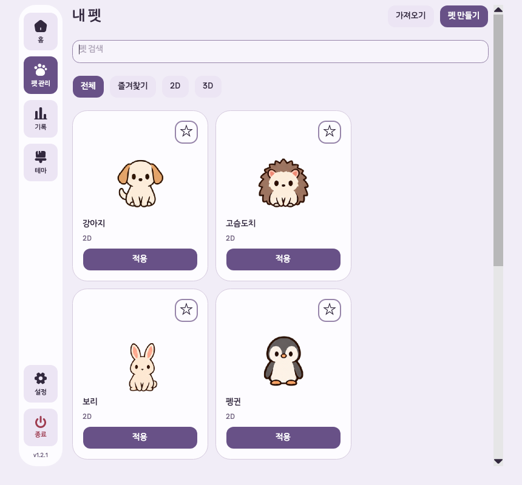
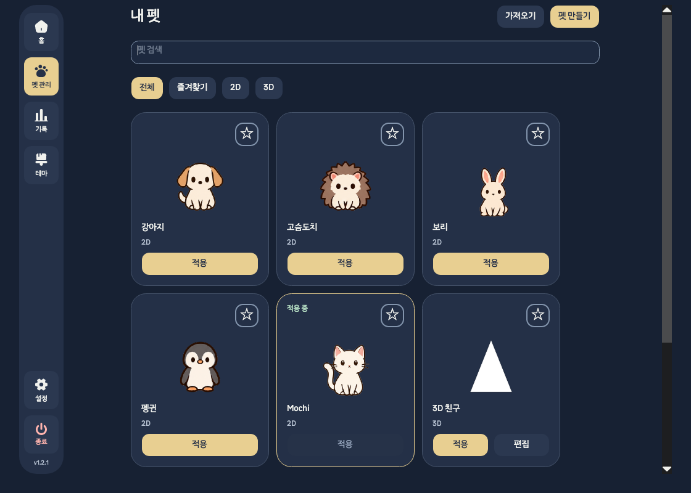

# 동료 펫 P1 구현·집중 검증

2026-10-20. [실행 계획](../plans/2026-10-20-companion-p1.md)의 S1→S2→S3→S4를 최신 개발 작업트리에 적용했다.
이 기록은 공개 v1.2.1의 배포 검증과 구별한다.

## 소스와 작업 범위

- 작업트리: `/Users/hwanghyeonseong/Developer/GitHub/Unfold/.worktrees/pet-overlay-hover`
- 브랜치·시작 HEAD: `codex/pet-overlay-hover`, `2de478a7fb4b96bb92148b641c796a885270cf0d`. 시작 시 clean, upstream과 0/0.
- 프로젝트 버전: `1.2.1`. 이번 변경은 미커밋·미배포이며 버전은 올리지 않았다.
- 공개 v1.2.1 제품 소스: `09c9e72`. 다른 작업트리와 설치된 앱·사용자 데이터는 수정하지 않았다.
- 검증 빌드 입력: 현재 작업트리의 Core/Desktop/Tests 프로젝트. 테스트가 생성한 실행 어셈블리는 `src/Unfold.Desktop/bin/Release/net10.0/Unfold.dll`.
- 기존 MVP·개발 계획을 이력으로 구분하고 새 P1 계획을 현재 실행 진입점으로 연결했다. 기존 문서를 삭제하거나 이동하지 않았다.

## 구현 결과

### S1 — 펫별 크기·즐겨찾기

`PetPreferences`에 ID별 크기와 즐겨찾기를 저장한다. 현재 펫의 전역 `PetScalePercent`를 유지하여
이전 설정 파일·기존 크기 슬라이더와 호환한다. 아직 개별 크기가 없는 펫은 현재 전역 크기를 초기값으로 쓴다.

- 홈·가져오기·라이브러리의 선택 경로가 같은 설정 전환을 사용한다.
- 펫 A 80%→B 130%→A 선택 시 80%로 복원한다.
- 사용자가 변경한 설정은 저장 성공 후 런타임에 반영한다.
- 명시적으로 삭제한 펫의 선호는 제거한다. 재시작 시 누락/손상된 펫은 대체 펫의 ID·크기로 정규화한다.
- 자동 대체 시 사라진 펫의 선호는 남겨 복구된 팩에 재사용한다. 자동 복구 설정을 저장할 수 없으면 로그를 남기고 이번 세션의 대체 선택을 사용한다.
- 개별 선호의 손상은 다른 설정·다른 펫의 선호를 잃지 않고 복구한다.
- 사전은 불변 스냅샷이며 설정 레코드의 저장/로드 값 동등성을 유지한다.

주요 파일: [AppSettings.Pets](../../src/Unfold.Core/AppSettings.Pets.cs),
[PetPreference](../../src/Unfold.Core/PetPreference.cs), [AppRuntime](../../src/Unfold.Desktop/AppRuntime.cs).

### S2 — 내 펫 라이브러리

펫 관리 첫 화면을 보유 펫 목록으로 바꿨다. 정지 썸네일·이름·2D/3D·적용 중 상태·즐겨찾기를 표시한다.
이름 검색과 전체/즐겨찾기/2D/3D 필터를 제공한다. 기본 펫은 적용할 수 있고 편집 버튼은 표시하지 않는다.

- 적용과 편집은 별도 버튼이다. 기존 미디어/GLB 편집기와 팩 가져오기 계약을 재사용한다.
- `목록으로`는 초안을 보존한다. `계속 편집`은 보존된 초안을 열며, `새로 만들기`에서 미저장 초안을 버릴 때만 확인한다.
- 저장·삭제·현재 선택·즐겨찾기 변경을 목록에 반영한다.
- `CharacterPackage.StillImage`로 최대 216px 정지 비트맵을 만든다. 카드 탐색 때문에 전체 GLB나 애니메이션을 로딩하지 않는다.
- 일반 상태 갱신은 비트맵을 다시 만들지 않는다. 목록 교체·필터 변경·폐기 시 이미지 참조와 비트맵을 해제한다.
- 내부 화면 전환의 초점, 초기 빈 목록, 대소문자가 다른 ID의 적용 표시를 보완했다.

주요 파일: [PetLibraryView](../../src/Unfold.Desktop/PetLibraryView.cs),
[PetManagementView](../../src/Unfold.Desktop/PetManagementView.cs), [PetBuilderView](../../src/Unfold.Desktop/PetBuilderView.cs).

### S3 — 선택형 CPU·메모리 정보

설정의 `호버 바에 CPU·메모리 표시`는 기본 off다. 켜면 호버 바 아래 두 줄을 더한다.
창 폭은 208px, 기본 높이는 78px이며 정보를 켜면 122px이다. 펫 창 자체를 이동하거나 늘리지 않는다.

- 표시될 때 첫 샘플을 읽고, 계속 표시되는 동안 5초 간격으로 수집한다.
- off·비호버·숨김·종료 상태에서 반복 수집을 중지한다. UI 스레드 밖에서 읽고 공유 semaphore로 세대가 바뀌어도 중복 수집을 막는다.
- 숨김·종료 전 시작된 늦은 결과와 큐에 남은 UI 게시를 폐기한다.
- CPU는 시스템 전체의 누적 busy/total 차분이다. 첫 샘플·0 분모·카운터 역행·수집 실패는 `—`로 표시한다.
- macOS 메모리는 **전체 물리 RAM−free 페이지**, 파일 캐시 포함 점유량이다. Activity Monitor의 메모리 사용이나 메모리 압력과 같은 값이라고 주장하지 않는다.
- Windows 메모리는 **전체 물리 RAM−가용 물리 RAM**이다. CPU는 여러 processor group인 경우 전체값으로 오인시키지 않도록 미확정으로 둔다.
- 단위는 십진 GB(10⁹ bytes)다. 집계 정의는 설정 체크박스 도움말과 접근성 이름으로 확인할 수 있다.
- 정보 영역은 입력을 통과시킨다. 언어를 바꾸면 열려 있는 호버 바의 행 이름도 갱신한다.
- 재진입과 15초 초과 샘플 간격에서 CPU 기준을 다시 잡는다. 별도 OS wake 이벤트는 등록하지 않았다.

주요 파일: [SystemResourceMonitor](../../src/Unfold.Desktop/SystemResourceMonitor.cs),
[NativeSystemResourceSource](../../src/Unfold.Desktop/NativeSystemResourceSource.cs),
[PetTimerWindow](../../src/Unfold.Desktop/PetTimerWindow.cs).

### S4 — 호버 빠른 메뉴

기존 호버 바 오른쪽 위 메뉴에서 `내 펫`, `알림 소리 켜기/끄기`, `설정`을 연다.
기존 재생/일시정지·중지 버튼과 펫 우클릭 숨기기를 유지한다.

- 열려 있는 메뉴는 호버와 배치를 유지한다. 숨김·호버 바 해제·펫 누름/들기·종료 시 닫는다.
- 라이브러리와 설정은 기존 설정 창을 재사용한다. 라이브러리로 돌아갈 때 편집 초안을 보존한다.
- 소리 토글은 기존 설정과 저장 파일에 반영되며 타이머 상태를 바꾸지 않는다.
- 미완성 대사 초안이 있어도 빠른 메뉴의 소리 변경을 설정 폼에 병합해 다음 편집이 이전 값으로 되돌리지 않게 했다.

## 코드 검사에서 확인해 고친 문제

| 유효한 문제 | 보완과 회귀 근거 |
|---|---|
| 저장한 펫이 시작 시 누락/손상되면 대체 펫에 이전 크기를 적용 | Reload의 선택·크기 정규화, 누락/손상 재시작 검사 |
| `Cat`/`cat` 두 ID에 적용 중 표시가 겹침 | 기존 ID 계약과 같은 Ordinal 비교, 메모리 목록 fixture 검사 |
| 초기 빈 라이브러리의 안내 누락·내부 편집 전환 초점 누락 | 초기 렌더와 편집기 초점 검사 |
| 입력 통과 영역의 메모리 툴팁에 접근할 수 없음 | 정의를 설정 도움말에 제공, 정보 영역의 입력 통과 유지 검사 |
| 언어 변경 후 메모리 행 이름이 이전 언어로 남음 | 기존 창의 라벨 갱신, 언어 전환 검사 |
| 미완성 대사 초안 이후 빠른 메뉴의 소리 토글이 되돌아감 | 외부 소리 변경만 폼에 병합, 초안 보존·후속 입력 검사 |

첫 검사의 일부 실패는 테스트 진입 방식이었다. 새 라이브러리를 거쳐 편집기를 여는 단계와
Avalonia의 지연된 TextChanged/Loaded 반영을 기다리도록 수정했다. 기존 검증 의미를 제거하지 않았다.
수정 범위 밖의 기능을 바꾸거나 오래된 이슈를 추정만으로 결함으로 등록하지 않았다.

## 검증

최종 현재 소스의 **214개 모두 통과**, 실패 0·건너뜀 0. Release 빌드도 이 실행에서 통과했다.
2026-10-20 20:43 KST 실행이며 테스트 소요는 24초다.
[원본 TRX](2026-10-20-companion-p1/focused.trx)의 최종 결과를 기준으로 집계하며,
단계별 재실행 횟수를 더하지 않았다.

| 최종 집중 범위 | 통과 |
|---|---:|
| S1 펫별 설정 Core 27·Runtime 6 | 33 |
| S2 라이브러리·테마/크기 | 16 |
| S3 수집기/native probe 11·UI 9 | 20 |
| S4 빠른 메뉴·초안/소리 동기화 | 16 |
| 기존 호버·타이머·입력·배치 | 34 |
| 기존 설정 복구·저장 신뢰성 | 24 |
| 언어 테이블·UI 번역 | 17 |
| 직접 영향받는 편집·저장·삭제·초안·탐색 경로 | 54 |
| 합계 | **214** |

코드 리뷰는 변경된 저장·선택·목록·수집 수명·호버 메뉴와 연결된 설정 폼에 한정했다.
확인된 문제를 위 표의 보완과 회귀 검사에 연결했다. `git diff --check`도 통과했다.

검사 명령은 저장된 [집중 필터](2026-10-20-companion-p1/focused-filter.txt)를 사용한다.
신규 기능 검사와 그 기능이 영향을 주는 기존 편집·초안 보호·호버·설정 복구 검사만 선택한다.
전체 테스트·전체 smoke·패키징·배포는 실행하지 않는다.
런타임/UI 검사는 격리된 `UNFOLD_DATA_DIR`을 사용했다.

```sh
dotnet test Tests/Unfold.Tests/Unfold.Tests.csproj \
  -c Release --no-restore --disable-build-servers -m:1 \
  --filter "$(cat docs/validation/2026-10-20-companion-p1/focused-filter.txt)" \
  --logger 'trx;LogFileName=focused.trx' \
  --results-directory docs/validation/2026-10-20-companion-p1
```

## 화면 증거와 한계

아래 이미지는 Avalonia 헤드리스 렌더다. 실제 macOS 창·물리 포인터 조작의 증거는 아니다.
라이브러리는 네 테마×860/1120 폭의 8개 배치를 검사했다. 호버 이미지의 CPU·메모리 숫자는 가짜 수집기의 테스트 값이다.
빠른 메뉴는 네 언어의 항목·키보드·기능을 검사했지만, 헤드리스 팝업은 작은 타이머 창 안의
overlay host에 렌더되어 아래쪽이 잘린다. 그 캡처는 정상 네이티브 메뉴 배치의 증거에서 제외했다.
실제 OS 팝업의 크기·화면 가장자리 배치는 미검증이다.






macOS 실제 native 두 샘플 검사는 CPU 카운터 차분·RAM 범위와 Mach 구조체/페이지 크기·포트 반환 경로를 확인했다.
Windows native 실행, 실제 macOS/Windows 메뉴·키보드·포인터, 잠자기/깨우기, 장시간 전력·메모리 비용,
설치 앱 교체와 업데이트는 이번에 검증하지 않았다. 짧은 절전 중 CPU 평균 경계도 별도 확인이 필요하다.
