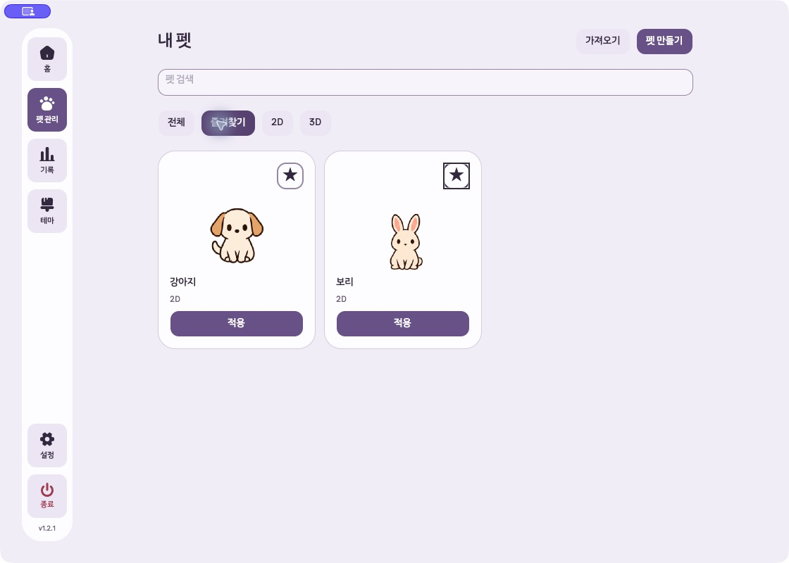
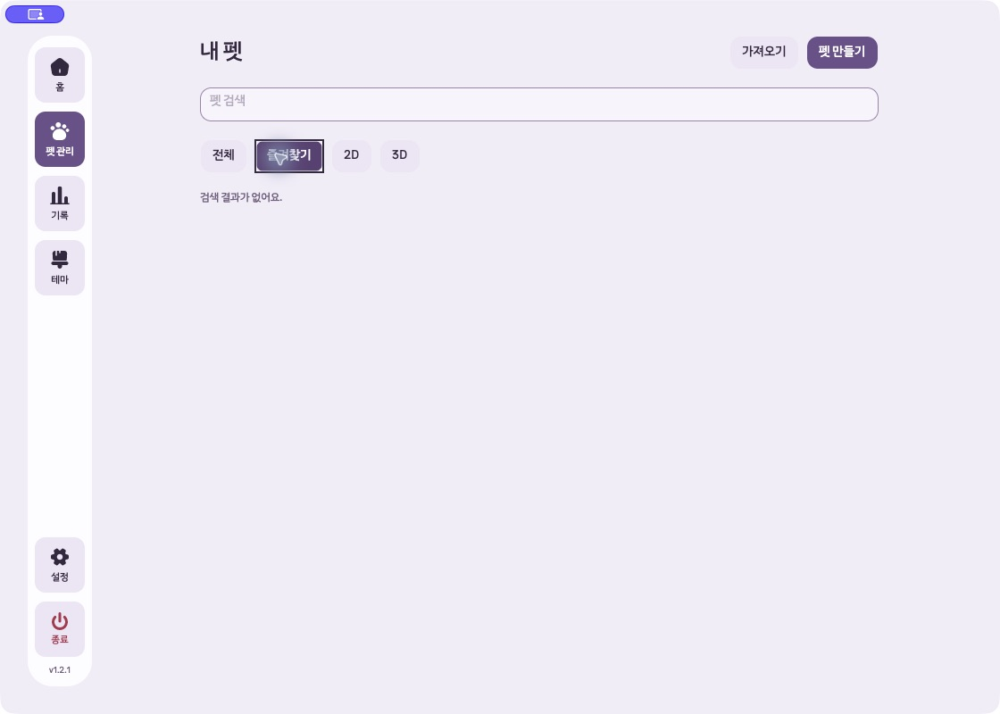

# 즐겨찾기 키보드 포커스 수정·검증

2026-10-20 수정 시작, 2026-10-21 실제 macOS 검증 완료. [이전 네이티브 QA](2026-10-20-companion-p1-macos.md)의 P2 포커스 유실을 수정했다.

## 원인

즐겨찾기 저장 중 `IsBusy`가 현재 버튼을 비활성화하면서 키보드 포커스가 사라졌다. 저장 후 버튼을 다시 활성화해도 포커스를 복원하지 않았다. 즐겨찾기 필터에서는 해제한 카드가 제거되고 목록의 컨트롤이 재생성되므로 이전 버튼만 다시 포커스하는 처리로는 해결되지 않는다.

## 변경

- 즐겨찾기를 실행한 버튼의 포커스 여부, 입력 방식, 목록 위치를 저장한다.
- 저장 후 같은 펫이 보이면 해당 즐겨찾기 버튼으로 복귀한다.
- 카드가 사라지면 같은 위치에 들어온 다음 카드로 이동한다. 마지막 카드였다면 이전 카드로 이동한다.
- 결과가 비면 현재 필터 버튼으로 이동한다.
- 저장 실패 시에도 사용 가능한 원래 버튼으로 복귀한다.
- 기다리는 동안 사용자가 다른 컨트롤로 포커스를 옮긴 경우에는 포커스를 빼앗지 않는다. 페이지가 닫히거나 분리된 경우에도 복원하지 않는다.
- 키보드·마우스의 기존 포커스 표시 방식을 유지한다.
- 관련 테스트 fixture에 `UNFOLD_DATA_DIR` 설정·복구를 추가해 의도된 오류 로그도 테스트 임시 디렉터리를 사용하게 했다.

## 소유 파일

- [`PetLibraryView.cs`](../../src/Unfold.Desktop/PetLibraryView.cs): 즐겨찾기 작업의 포커스 복원
- [`PetLibraryTests.cs`](../../Tests/Unfold.Tests/PetLibraryTests.cs): 포커스 회귀 검사 7개 및 fixture 데이터·로그 격리
- 이 검증 문서와 [증거 폴더](2026-10-21-favorite-focus/)

작업 시작 시 파일 해시와 최종 파일을 비교하여, 기존 파일 중 위 제품·검사 파일 2개만 변경된 것을 확인했다. 앞선 P1 미커밋 변경과 다른 작업트리는 보존했다. 새 안내 문구나 화면 요소는 추가하지 않았다.

## 검증

### 기준

- 작업트리: `/Users/hwanghyeonseong/Developer/GitHub/Unfold/.worktrees/pet-overlay-hover`
- 브랜치: `codex/pet-overlay-hover`
- HEAD: `2de478a7fb4b96bb92148b641c796a885270cf0d`, 버전 `1.2.1`, 기존 P1 미커밋 변경 포함
- 원격 브랜치도 같은 HEAD. GitHub 최신 릴리스는 `v1.2.1`, 제품 소스 `09c9e729138dc01822f6639654c7e983e2825f0e`
- 실행 DLL SHA-256: `58decfa768e047e897bc61e51b24c3091aaac4c360ee9adc8ba6bb51faddbaf1`

### 자동 검사

수정 전 새 회귀 검사 7개 중 **6개 실패·1개 통과**로 기존 결함을 확인했다. 수정 후 새 검사 7개와 기존 즐겨찾기 저장 실패·재시도 검사 1개, **총 8개 통과**(실패·건너뜀 0).

최종 fixture 격리를 반영한 동일 8개 검사도 새 임시 데이터로 통과했다. 필터는 다음 메서드만 포함했다:

- `FavoriteKeyboardActivationKeepsFocusAndTabOrderEvenWhenSavingFails` — 성공/실패 2개
- `RemovingFavoriteFocusesTheNextCardOrThePreviousLastCard` — 처음/중간/마지막 3개
- `RemovingTheOnlyFavoriteFocusesTheFavoritesFilter`
- `FavoriteCompletionDoesNotTakeFocusBackFromAnotherControl`
- `FailedFavoriteWriteKeepsTheSavedStateAndCanBeRetried`

검사 프로젝트의 Release 빌드 및 네이티브 검증 호스트 Release 빌드 성공. 호스트 빌드 경고/오류 0개. `git diff --check` 통과. 전체 테스트·전체 smoke는 실행하지 않았다.

근거: [수정 전 TRX](2026-10-21-favorite-focus/before.trx), [최종 격리 검사 TRX](2026-10-21-favorite-focus/after.trx).

### 실제 macOS

이전 검증에 사용한 현재 제품 런타임 기반 임시 호스트를 새 경로에서 빌드했다.

- 앱: `/private/tmp/unfold-favorite-focus-20261020/Unfold Favorite Focus QA.app`
- 데이터: `/private/tmp/unfold-favorite-focus-20261020/profile`
- 일반 네이티브 Avalonia 창 `1120×800`, 기본 펫 3개의 즐겨찾기만 테스트 초기값으로 지정
- 관찰 도구는 키보드·포커스 이벤트와 현재 컨트롤 상태를 읽었다. 검사 동작은 macOS UI 도구의 실제 키 입력과 클릭으로 수행했다.
- 실행 앱의 제품 DLL과 현재 작업트리 Release DLL의 해시 일치를 확인했다.

| 실제 입력 경로 | 결과 |
|---|---|
| 전체 목록에서 Tab으로 강아지 별 이동 → Space 해제 | 같은 별 버튼에 포커스 유지 |
| 이어서 Tab | 강아지 적용 버튼으로 이동 |
| Shift+Tab → Space 재추가 | 같은 별 버튼에 포커스 유지, 저장 상태 변경 |
| 즐겨찾기 첫 카드 강아지 제거 | 다음 카드 고슴도치 별로 이동; Tab은 고슴도치 적용 |
| 즐겨찾기 중간 카드 고슴도치 제거 | 다음 카드 보리 별로 이동 |
| 마지막 카드 보리 제거 | 이전 카드 강아지 별로 이동; Tab은 강아지 적용 |
| 유일한 카드 강아지 제거 | 빈 결과 표시, 즐겨찾기 필터로 이동 |
| 빈 목록에서 Tab | 다음 필터 2D로 이동 |
| 클릭으로 즐겨찾기 재추가 | 상태·포커스 유지 정상 |

위 경로 모두 통과. 앱 예외 및 observer 오류는 없었다. UI의 정상 종료 절차로 테스트 앱을 종료했고 종료 코드 0을 확인했다.

근거: [실행 환경](2026-10-21-favorite-focus/environment.json), [네이티브 입력·포커스 이벤트](2026-10-21-favorite-focus/native-events.jsonl), [최종 격리 설정](2026-10-21-favorite-focus/settings-after-native.json).

## 격리 예외와 보완

초기 자동 검사에서 fixture가 펫 파일만 임시 폴더에 저장하고 `AppPaths.Log`의 전역 데이터 경로를 바꾸지 않았다. 그 결과 의도적으로 발생시킨 `favorite write failed` 로그 **3건**이 기존 `~/Library/Application Support/Unfold/unfold.log`에 추가됐다(2026-10-20 23:52:39, 23:53:21, 23:53:23 KST).

사용자에게 알렸으며 기존 로그를 삭제·편집하지 않았다. 테스트 fixture의 데이터 경로 설정을 보완한 뒤 동일 범위 검사와 macOS 검증을 수행했다. 보완 시점과 최종 검증 후 기존 `settings.json` 및 `unfold.log`의 SHA-256이 동일함을 확인했다. 실제 사용자 설정·펫 데이터는 변경하지 않았다. 네이티브 앱은 처음부터 위의 새 격리 프로필만 사용했다.

## 미검증·위험

- 저장 실패와 비동기 저장 중 다른 컨트롤로 이동하는 경로는 자동 검사로 확인했다. 실제 디스크 장애를 macOS 프로필에 주입하지 않았다.
- 네이티브 실행은 실제 제품 DLL을 사용하는 임시 호스트다. 계정·로그인·설치·업데이트 흐름은 범위 밖이다.
- Windows, 전체 라이브러리 기능, 호버 메뉴·모서리 배치는 이번 수정 범위가 아니므로 다시 검사하지 않았다.
- 제품 변경은 현재 작업트리에 미커밋으로 남겼다. 설치 앱 교체·푸시·배포는 수행하지 않았다.

## 실제 화면

중간 카드 제거 후 다음 카드인 보리의 별 버튼에 포커스:

마지막 남은 카드 제거 후 즐겨찾기 필터에 포커스:

